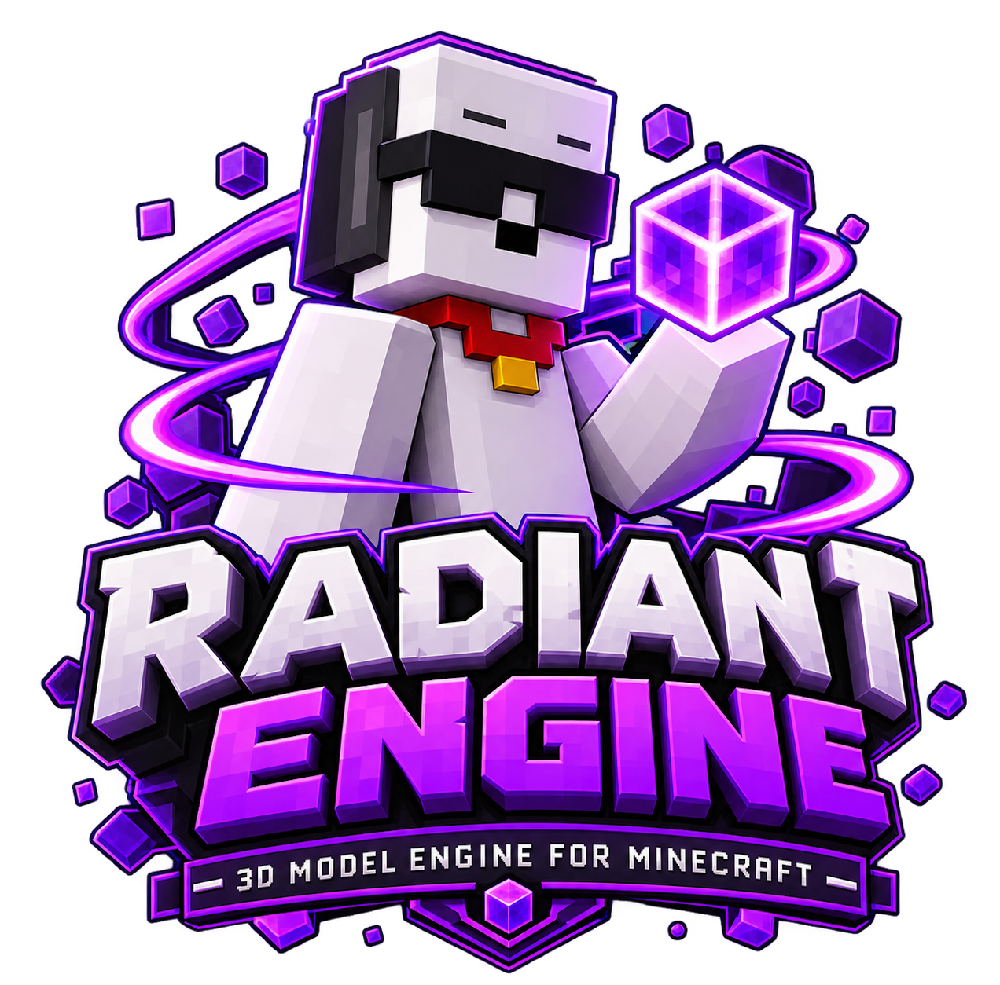

<p align="center">
  
</p>

# RadiantEngine

**3D Model Engine for Minecraft**

RadiantEngine is a Minecraft plugin that allows you to load, animate and display Blockbench models using Minecraft's Display Entities.

Models are loaded directly from `.bbmodel` files, preserving their bone hierarchy, animations, textures and transformations. No NMS, ProtocolLib or ArmorStands required.

**Supported versions:** Paper / Spigot 1.21.x – 26.x  
**Java:** 21+


---

## Features

- **Blockbench support:** Load `.bbmodel` files with bone hierarchies, pivots, rotations, face UVs and embedded textures.
- **Animation system:** Supports linear, catmull-rom, bezier and step interpolation, with `loop`, `once` and `hold` playback modes.
- **Display Entity rendering:** Models are rendered using `ItemDisplay` entities and native transformations.
- **Bone transformations:** Position, rotation and scale are inherited through the model hierarchy using quaternions.
- **Animation layers:** Play multiple animations with fade-in, fade-out and override support.
- **Automatic states:** `idle`, `walk`, `jump`, `fly`, `attack`, `death` and `spawn`.
- **Hitboxes:** Interaction entities for damage handling and player interaction.
- **Player disguises:** Apply models to players, including movement, head tracking, jumping and attacks.
- **Mounts:** Driver and passenger seats with GROUND, FLYING, SWIMMING and AMPHIBIOUS movement, banking and rideable pets.
- **3D holograms:** Animated, rotating and player-facing models with text and commands.
- **3D pets:** Pets that follow their owner with state-based animations, per-user assignments and a GUI.
- **3D cosmetics:** Back, head and orbit cosmetics synced with the player body, posture and movement.
- **Bedrock support:** Floodgate/Geyser detection, generated Bedrock pack and runtime adjustments for Bedrock players.
- **Nametags:** Custom labels using TextDisplay entities.
- **Resource pack generation:** Generates model assets, textures, item definitions and pack files automatically.
- **Custom branding:** Your own `logo.png` is used for the pack icon, menu header and menu logo item.
- **Integrations:** Oraxen, MythicMobs, Citizens, FancyNpcs, ZNPCsPlus, WorldGuard, PlaceholderAPI, Floodgate and Geyser.
- **MiniMessage:** Configurable messages and formatting.

## Installation

1. Download the latest `RadiantEngine-x.y.z.jar`.
2. Place the JAR inside your server's `plugins` folder.
3. Start the server to generate the configuration files.
4. Place your Blockbench `.bbmodel` files inside:

   `plugins/RadiantEngine/blueprints/`

   Subfolders are supported.

5. Run `/radiant reload`.
6. Distribute the generated resource pack located at:

   `plugins/RadiantEngine/resource_pack.zip`

   If Oraxen is installed, you can use its generated resource pack instead.

## Bone Tags

RadiantEngine uses bone names and prefixes to identify special model components.

| Bone name / Prefix | Description |
|---|---|
| `hitbox` | Main hitbox. Its pivot determines the eye height. |
| `h_` | Head bone. Follows the entity's look direction. |
| `g_` | Ghost bone. Not rendered, but its children are animated. |
| `mount` | Driver seat with WASD and jump controls. |
| `p_` | Passenger seat. |
| `tag_` | Nametag attachment point. |
| `ir_` | Right-hand item attachment. |
| `il_` | Left-hand item attachment. |
| `ih_` | Head item attachment. |
| `item_` | Custom item attachment through the API, item-links or Oraxen. |
| `b_`, `ob_`, `hitbox_`, `subhitbox_` | Additional hitboxes attached to bones. |

## Commands

Main command: `/radiant`

Aliases: `/re`, `/rengine`

| Command | Description | Permission |
|---|---|---|
| `/radiant reload [models\|config\|pack]` | Reload models, configuration or resource pack. | `radiantengine.command.reload` |
| `/radiant list [page]` | List loaded models. | `radiantengine.command.list` |
| `/radiant info <model>` | Display model information. | `radiantengine.command.list` |
| `/radiant spawn <model> [entity] [count] [spread]` | Spawn one or more entities with a model. | `radiantengine.command.spawn` |
| `/radiant summon <model> [x y z [yaw]] [count] [spread]` | Spawn one or more static models. | `radiantengine.command.summon` |
| `/radiant apply <model> [hideBase]` | Apply a model to a targeted entity or selected Citizens NPC. | `radiantengine.command.apply` |
| `/radiant remove [radius]` | Remove nearby models. | `radiantengine.command.remove` |
| `/radiant kill [model] [radius]` | Remove active rigs. | `radiantengine.command.kill` |
| `/radiant killall [radius]` | Remove all rigs and orphaned parts. | `radiantengine.command.kill` |
| `/radiant disguise <model> [player]` | Apply a player disguise. | `radiantengine.command.disguise` |
| `/radiant undisguise [player]` | Remove a player disguise. | `radiantengine.command.disguise` |
| `/radiant selfview <full\|headless\|none>` | Configure your own disguise visibility. | `radiantengine.command.disguise` |
| `/radiant playanim <model> <anim> [lerpIn] [lerpOut] [vel] [force]` | Play a model animation. | `radiantengine.command.playanim` |
| `/radiant stopanim` | Stop an animation. | `radiantengine.command.playanim` |
| `/radiant tint <model> <RRGGBB\|reset>` | Change the model tint. | `radiantengine.command.tint` |
| `/radiant mount [seat]` | Mount a model. | `radiantengine.command.mount` |
| `/radiant dismount` | Dismount a model. | `radiantengine.command.mount` |
| `/radiant npc <id> <model\|remove>` | Assign or remove an NPC model. | `radiantengine.command.npc` |
| `/radiant npc list` | List registered NPC models. | `radiantengine.command.npc` |
| `/radiant gui` | Open the model selection menu. | `radiantengine.command.gui` |
| `/radiant pet <gui\|summon\|ride\|dismiss\|list\|assign\|unassign>` | 3D pets. | `radiantengine.command.pet` |
| `/radiant cosmetic <gui\|equip\|unequip\|list\|assign\|unassign>` | 3D cosmetics. | `radiantengine.command.cosmetic` |

Additional permissions:

- `radiantengine.*` — All permissions.
- `radiantengine.admin` — Administrator access.
- `radiantengine.command.disguise.others` — Manage other players' disguises.
- `radiantengine.bypass.region` — Bypass region restrictions.
- `radiantengine.pet.<id>` / `radiantengine.pet.*` — Access to pets.
- `radiantengine.cosmetic.<id>` / `radiantengine.cosmetic.*` — Access to cosmetics.

## Spawning Multiple Models

`/radiant spawn` and `/radiant summon` accept an optional amount and spread radius:

```text
/radiant spawn dragon 5                 # 5 dragons on the default entity, default spread (2 blocks)
/radiant spawn dragon husk 8 6          # 8 dragons on husks inside a 6 block radius
/radiant summon statue 4 3              # 4 static statues around you, 3 block radius
/radiant summon statue 100 64 -20 90 6 5   # at coordinates, yaw 90, 6 statues, 5 block radius
/radiant summon statue ~ ~ ~ count:10 spread:8   # named arguments work in any position
```

- Instances follow an even golden-angle spiral, so they never overlap; the radius grows automatically when it is too
  small for the amount (`spawn.multi.min-spacing`).
- Each instance is placed on nearby safe ground (`spawn.multi.safe-ground`) and WorldGuard's `radiant-allow-spawn` is
  checked for every point.
- `spawn.multi.max-count` (default 50) and `spawn.multi.max-spread` cap the commands to avoid accidental huge spawns.

```java
List<ActiveRig> group = RadiantAPI.spawnRigs(location, "dragon", EntityType.HUSK, 5, 4.0);
List<ActiveRig> props = RadiantAPI.spawnStaticRigs(location, "statue", 6, 5.0);
List<Location> preview = RadiantAPI.getSpreadLocations(location, 6, 5.0);
```

## Mounts and Vehicles

The `mount` bone is the driver seat and `p_1`, `p_2`, `p_3`... are passenger seats. Passengers keep fighting and
interacting normally: the vehicle's own hitboxes are hidden from its riders so they never hit their own mount. Models
without seat bones seat the driver on the base entity itself (`base-seat: true`).

Each model has a driving profile in `plugins/RadiantEngine/mounts.yml` (models without an entry use `default`):

| Movement | Behaviour |
|---|---|
| `GROUND` | Gravity, jumping and automatic step climbing (`step-height`). |
| `FLYING` | Free flight following the driver's look: `WASD` to move/strafe, `Space` to climb, `Shift` to descend (or dismount). |
| `SWIMMING` | Smooth underwater movement with thrust and buoyancy; slow crawling out of water. |
| `AMPHIBIOUS` | Switches automatically: water = swimming, `Space` in the air = flying, ground = walking. |

```yaml
mounts:
  dragon:
    movement: AMPHIBIOUS
    fly-speed: 0.6
    vertical-speed: 0.35
    shift-action: DESCEND      # DESCEND or DISMOUNT
    pitch-follow: 0.5          # how much the model pitches with the driver's look while flying / swimming
    banking:
      enabled: true
      intensity: 1.6           # roll degrees per degree turned in a tick
      max-angle: 35
      smoothing: 0.18
```

**Banking:** the yaw change of the driver is turned into a smooth roll of the whole model (left/right) using
quaternions, limited by `max-angle`.

Shift-to-descend needs the player input API (1.21.2+); on older servers Shift always dismounts.

### Rideable pets

Pets with `rideable: true` in `pets.yml` can be ridden by their owner from the pet GUI (right click), with
`/radiant pet ride [pet]` or by right clicking the pet (`pets.ride.interact`). While ridden the pet uses its mount
profile (`mount-profile`, default: its model id) including banking; when the owner gets off it goes back to following
them. Other players can join as passengers on `p_` seats (`pets.ride.allow-passengers`). Permission:
`radiantengine.pet.ride` (everyone by default) plus access to the pet.

```yaml
pets:
  dragon:
    model: dragon
    movement: FLY
    rideable: true
    mount-profile: dragon
```

```java
RadiantAPI.ridePet(player);                          // ride the summoned pet
RadiantAPI.ridePet(player, "dragon");                // summon if needed and ride
MountProfile profile = RadiantAPI.getMountProfile("dragon");
MountProfile.Mode mode = RadiantAPI.getMountMode(vehicleEntity);   // GROUND, FLYING, SWIMMING or null
```

## 3D Holograms

RadiantEngine includes a hologram system that uses Blockbench models. Holograms are persistent and saved in `holograms.yml`.

### Hologram modes

| Mode | Description |
|---|---|
| `spin` | Rotates around the Y axis and floats using a sine animation. |
| `billboard` | Always faces each player individually. |
| `static` | Keeps its original orientation. |

Additional features:

- Cyan tint and maximum brightness (`15/15`).
- Optional glowing outline.
- Particle ring around the base.
- Text above or below the model.
- MiniMessage and PlaceholderAPI support.
- Right-click command execution.
- No gravity, AI or damage.

### Examples

```text
/radiant holo create portal_spawn portal spin 1.5
/radiant holo text portal_spawn <gradient:#00E5FF:#3B82F6>Travel to Lobby</gradient>
/radiant holo command portal_spawn warp lobby
/radiant holo command tienda console:shop open {player}
/radiant holo movehere portal_spawn
/radiant holo mode portal_spawn billboard
/radiant holo remove portal_spawn
```

### Hologram commands

| Command | Permission |
|---|---|
| `/radiant holo create <id> <model> [spin\|billboard\|static] [scale]` | `radiantengine.command.holo` |
| `/radiant holo remove <id>` | `radiantengine.command.holo` |
| `/radiant holo movehere <id>` | `radiantengine.command.holo` |
| `/radiant holo list` | `radiantengine.command.holo` |
| `/radiant holo text <id> [above\|below] <text\|none>` | `radiantengine.command.holo` |
| `/radiant holo command <id> <command\|none>` | `radiantengine.command.holo` |
| `/radiant holo mode <id> <spin\|billboard\|static>` | `radiantengine.command.holo` |

### Hologram API

```java
HologramRig holo = RadiantAPI.spawnHologram(
    "portal_spawn",
    location,
    "portal",
    HologramMode.SPIN,
    1.5f
);

RadiantAPI.setHologramText(
    "portal_spawn",
    "<aqua>Travel to Lobby"
);

RadiantAPI.setHologramCommand(
    "portal_spawn",
    "warp lobby"
);

RadiantAPI.removeHologram("portal_spawn");
```

## 3D Pets

Pets follow their owner, walking on the terrain or flying next to them, and teleport back when they are more than
`24` blocks away. Animations switch automatically with the owner's state: `idle`, `walk`, `sprint`, `jump`,
`owner_attack` and `owner_hurt` (plus `fly` for flying pets). Animation names are configurable in `config.yml`.

Pet definitions, per-user assignments and each player's equipped pet are stored in `plugins/RadiantEngine/pets.yml`:

```yaml
pets:
  dragon:
    model: dragon
    movement: FLY        # WALK or FLY
    scale: 0.5
    name: "<aqua>{player}'s dragon"
assignments:
  dragon: "Steve, Alex, 069a79f4-44e9-4726-a5be-fca90e38aaf5"   # names or UUIDs, list or comma separated
```

| Command | Description | Permission |
|---|---|---|
| `/radiant pet gui` | Open the pet menu. | `radiantengine.command.pet` (everyone by default) |
| `/radiant pet summon <pet>` | Summon a pet. | `radiantengine.command.pet` |
| `/radiant pet dismiss` | Dismiss your pet. | `radiantengine.command.pet` |
| `/radiant pet list` | List the pets you can use. | `radiantengine.command.pet` |
| `/radiant pet assign <player1,player2,...> <pet>` | Grant a pet to several players. | `radiantengine.admin` |
| `/radiant pet unassign <player1,player2,...> <pet>` | Revoke a pet from several players. | `radiantengine.admin` |

Access to each pet: `radiantengine.pet.<id>`, `radiantengine.pet.*` or a direct assignment in `pets.yml`.

## 3D Cosmetics

Cosmetics are attached to the player, follow the body rotation and posture (sneaking, gliding, swimming) and use the
`idle`, `walk`, `sprint`, `jump` and `fly` animations.

| Anchor | Typical use | Model origin |
|---|---|---|
| `back` | Wings, backpacks, swords | Player's feet, turns with the body |
| `head` | Hats, halos | Eye level, turns with the head (optional pitch) |
| `orbit` | Orbs, small companions | Orbits around the player (`radius`, `speed`, `height`) |

Head cosmetics are hidden from their owner so they never block the first person camera (`self-view: AUTO`).
Cosmetics are also hidden while the player is disguised or invisible (configurable).

```yaml
cosmetics:
  angel_wings: { model: angel_wings, anchor: back, offset: [0, 0, -0.05] }
  crown:       { model: crown, anchor: head, offset: [0, 0.3, 0] }
  spirit_orb:  { model: spirit_orb, anchor: orbit, radius: 1.1, speed: 120, height: 1.3, scale: 0.6 }
assignments:
  crown: [Steve, Alex]
```

| Command | Description | Permission |
|---|---|---|
| `/radiant cosmetic gui` | Open the cosmetics menu. | `radiantengine.command.cosmetic` (everyone by default) |
| `/radiant cosmetic equip <cosmetic>` | Equip a cosmetic. | `radiantengine.command.cosmetic` |
| `/radiant cosmetic unequip [cosmetic\|all]` | Remove one or all cosmetics. | `radiantengine.command.cosmetic` |
| `/radiant cosmetic list` | List the cosmetics you can use. | `radiantengine.command.cosmetic` |
| `/radiant cosmetic assign <player1,player2,...> <cosmetic>` | Grant a cosmetic to several players. | `radiantengine.admin` |
| `/radiant cosmetic unassign <player1,player2,...> <cosmetic>` | Revoke a cosmetic from several players. | `radiantengine.admin` |

Access to each cosmetic: `radiantengine.cosmetic.<id>`, `radiantengine.cosmetic.*` or a direct assignment in
`cosmetics.yml`.

## Bedrock Support (Geyser / Floodgate)

- Bedrock players are detected in real time through Floodgate (or Geyser) using reflection: no extra dependency and
  no errors when they are not installed.
- Every `/radiant reload` (or `/radiant reload pack`) generates `plugins/RadiantEngine/bedrock_pack/` and
  `bedrock_pack.mcpack` with `manifest.json`, `.geo.json` geometry, the original Blockbench animations, client entities
  and textures, as a starting point for Geyser custom entities or Bedrock add-ons.
- Runtime adjustments for Bedrock players (`bedrock:` section): pet and cosmetic scale, cosmetic vertical offset,
  reduced particles, optional hiding of heavy rigs and a dedicated disguise self view.

## Custom Branding

By default RadiantEngine uses its own logo (bundled in the jar: `branding/radiantengine.png` and the 96x96
`branding/radiantengine96.png` for small targets). To replace it, drop your logo into the plugin folder and run
`/radiant reload`:

```text
plugins/RadiantEngine/logo.png          (or assets/logo.png, branding/logo.png)
```

RadiantEngine then uses it automatically:

- **Pack icon:** `pack.png` of the Java resource pack and `pack_icon.png` of the Bedrock pack.
- **Menu header:** drawn on the right side of the custom menu background.
- **Logo item:** a flat item (with its own CustomModelData, also registered in Oraxen as `radiant_branding_logo`) used for
  the info button of the model, pet and cosmetic menus.
- **Oraxen pack icon:** optional (`branding.oraxen-pack-icon: true`).

Large images are downscaled smoothly and small pixel-art logos are upscaled without blur, keeping the aspect ratio on a
transparent square canvas. When no custom logo exists, or it cannot be read, the bundled RadiantEngine logo is used (a warning is logged for
unreadable files; nothing fails). Set `branding.use-default-logo: false` to use the plain generated icon instead. Everything is configurable in the `branding:` section of `config.yml`.

## Integrations

### Citizens, FancyNpcs and ZNPCsPlus

Models can be assigned directly to NPCs from supported NPC plugins.

```text
/radiant npc 12 knight
/radiant npc fancynpcs:guide wizard
/radiant npc znpcsplus:shop golem
/radiant npc 12 remove
```

NPC assignments are saved in `npcs.yml` and restored after server restarts and chunk reloads.

RadiantEngine automatically handles the `idle` and `walk` animations when supported by the NPC's movement state.

Interactions with the model's hitbox are forwarded to the underlying NPC.

### WorldGuard

RadiantEngine adds two WorldGuard flags:

| Flag | Default | Description |
|---|---|---|
| `radiant-allow-spawn` | `allow` | Controls model spawning. |
| `radiant-allow-mounts` | `allow` | Controls model mounting. |

Example:

```text
/rg flag spawn radiant-allow-spawn deny
/rg flag spawn radiant-allow-mounts deny
```

### PlaceholderAPI

Available placeholders:

| Placeholder | Description |
|---|---|
| `%radiant_active_models%` | Number of active model entities. |
| `%radiant_loaded_blueprints%` | Number of loaded blueprints. |
| `%radiant_player_disguise%` | Current player disguise. |
| `%radiant_player_mount%` | Current mounted model. |
| `%radiant_npc_models%` | Number of NPCs with assigned models. |
| `%radiant_player_pet%` | Equipped pet of the player. |
| `%radiant_player_cosmetics%` | Cosmetics worn by the player. |
| `%radiant_player_bedrock%` | `true` if the player is on Bedrock Edition. |

### Oraxen

When Oraxen is installed, RadiantEngine generates:

- `plugins/Oraxen/items/radiantengine_models.yml`
- Model assets inside `plugins/Oraxen/pack/assets/<namespace>/`

Oraxen items can be linked to `item_` bones through `item-links` or the API.

### MythicMobs

RadiantEngine provides MythicMobs skills for model handling.

```yaml
Skills:
  - model{m=dragon} @self ~onSpawn
  - state{m=dragon;s=roar;li=0.1;lo=0.2} @self ~onAttack
  - tint{m=dragon;c=FF0000} @self
  - mountmodel{m=dragon;d=true} @trigger ~onInteract
  - disguise{m=dragon} @trigger
```

Available targeters:

- `@ModelPassengers`
- `@ModelDriver`
- `@MountedModel`

## Developer API

RadiantEngine provides a Java API for other plugins.

Add RadiantEngine as a `provided` dependency and declare it in your `plugin.yml` using `depend` or `softdepend`.

### Examples

```java
import dev.privalo.radiantengine.api.RadiantAPI;
import dev.privalo.radiantengine.model.ActiveRig;

// Spawn a mob with a model
ActiveRig dragon = RadiantAPI.spawnRig(
    location,
    "dragon",
    EntityType.HUSK
);

RadiantAPI.playAnimation(dragon, "roar");

// Spawn a static model
RadiantAPI.spawnRig(location, "statue");

// Apply a model to an existing entity
RadiantAPI.applyRig(zombie, "knight");

// Change model tint
RadiantAPI.setTint(
    zombie,
    "knight",
    Color.fromRGB(0xFF5555)
);

// Apply a player disguise
RadiantAPI.applyDisguise(player, "werewolf");

// Remove disguise
RadiantAPI.removeDisguise(player);

// Get an active rig
ActiveRig rig = RadiantAPI.getActiveRig(entity, "knight");

// Remove model
RadiantAPI.removeRig(entity);

// Pets and cosmetics
RadiantAPI.summonPet(player, "dragon");
RadiantAPI.assignPet(List.of("Steve", "Alex"), "dragon");
RadiantAPI.equipCosmetic(player, "angel_wings");
RadiantAPI.assignCosmetic(List.of("Steve"), "crown");

// Bedrock detection (Floodgate / Geyser)
boolean bedrock = RadiantAPI.isBedrockPlayer(player);
```

### Events

Available API events:

- `BlueprintLoadEvent`
- `RigAttachEvent`
- `RigAnimationStartEvent` (cancellable)
- `RigAnimationEndEvent`

## Resource Pack Troubleshooting

If menu icons or models show the pink/black "missing texture" square:

1. Run `/radiant reload pack` and compare the printed **SHA-1** of `resource_pack.zip` with the `resource-pack-sha1`
   in `server.properties` (or your pack host). A different value means players still have an old pack.
2. Check the console: every exported GUI file is listed (menu font and texture, 3D icons, logo item with its
   CustomModelData) and any missing or broken file is reported with its exact path. Models whose files are missing never
   receive a CustomModelData, so nothing points to a file that does not exist.
3. On 1.21.4+ every item uses the `item_model` component with its own definition in `assets/<namespace>/items/...`
   (`generator.use-item-model: true`), so other plugins changing the base item (for example Oraxen) do not break it.
   `oraxen.use-oraxen-items` is disabled by default for the same reason.
4. Animated textures whose `.mcmeta` does not match the image size are removed automatically (they would render as
   missing textures).

## Building

Requirements:

- Java 21
- Maven

Clone the repository and run:

```bash
mvn package
```

The compiled JAR will be generated inside:

```text
target/RadiantEngine-<version>.jar
```

## License

RadiantEngine is licensed under the [MIT License](LICENSE).

Copyright © 2026 Privalo21.
